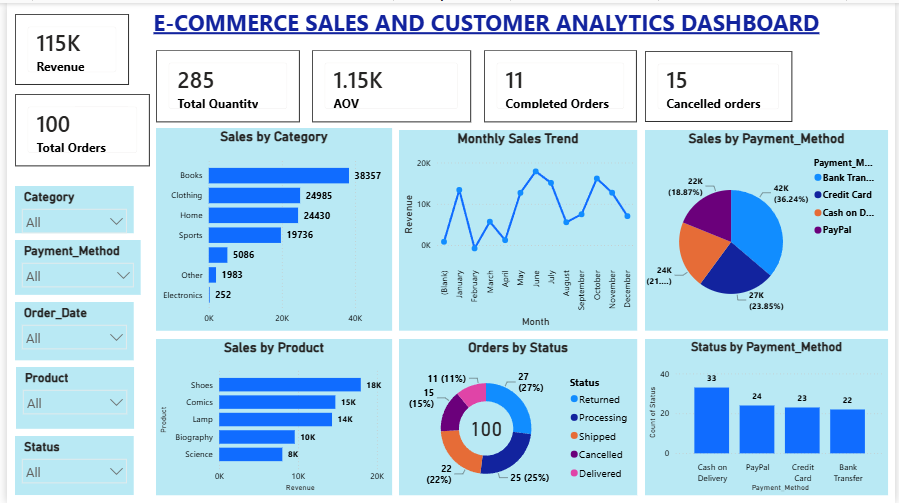

🛍️ E-Commerce Sales & Customer Analytics Dashboard

Transforming E-Commerce Data into Actionable Business Insights

📌 1. Project Overview

This project focuses on analyzing e-commerce sales and customer data using Microsoft Power BI.

An interactive dashboard was developed to monitor business performance, analyze sales trends, understand product category performance, and track order statuses.

The main objective is to transform raw e-commerce data into meaningful insights that support data-driven business decisions.

📂 2. Dataset Overview

The dataset contains e-commerce transaction information, including:

Order details

Product information

Product categories

Sales and quantity

Payment methods

Order status

Customer-related information

The dataset required data cleaning and transformation before analysis.

🎯 3. Business Objectives

Analyze overall revenue and sales performance.

Track monthly sales trends.

Identify top-performing product categories.

Understand payment method preferences.

Monitor completed and cancelled orders.

Evaluate overall order performance.

🧹 4. Data Cleaning & Preparation

Data preparation was performed using Power Query Editor in Power BI.

The following steps were carried out:

Promoting headers.

Removing duplicate records.

Replacing values where required.

Changing data types.

Applying locale-based data type conversion.

Creating custom columns.

Removing unnecessary columns.

Renaming columns for better readability.

📊 5. Key Performance Indicators (KPIs)

The dashboard tracks the following key metrics:

💰 Total Revenue

📦 Total Orders

🛒 Total Quantity

📈 Average Order Value (AOV)

✅ Completed Orders

❌ Cancelled Orders

🖥️ 6. Dashboard Preview

E-Commerce Sales & Customer Analytics Dashboard

🔍 7. Key Business Findings

Based on the dashboard analysis:

Total revenue is approximately 115K.

Total orders recorded: 100.

Total quantity sold: 285.

Average Order Value: approximately 1.15K.

Completed orders: 11.

Cancelled orders: 15.

These metrics provide an overview of sales performance and order status.

💡 8. Business Recommendations

Investigate the reasons behind cancelled orders.

Monitor monthly sales trends to identify performance changes.

Focus on product categories contributing to higher revenue.

Analyze payment preferences to improve the checkout experience.

Improve order completion rates through better order monitoring.

🛠️ 9. Tools & Technologies

Microsoft Power BI – Dashboard development and visualization.

Power Query Editor – Data cleaning and transformation.

DAX – KPI calculations and measures.

Microsoft Excel – Dataset handling and preparation.

🚀 10. How to Explore This Project

Download the Power BI .pbix file from this repository.

Open it using Microsoft Power BI Desktop.

Explore the interactive visuals, KPIs, and business insights.

📁 11. Project Files

E-Commerce Sales & Customer Analytics Dashboard.pbix – Interactive Power BI dashboard.

messy_ecommerce_sales_data-selected-columns(1).csv – Dataset used for analysis.

E-commerce_Dashboard.png.png – Dashboard preview.

README.md – Project documentation.

👩‍💻 12. About the Author

Devika Sutar

Aspiring Data Analyst | Excel | SQL | Python | Power BI

⭐ Thank You for Visiting My Project!

Learning • Analyzing • Improving

